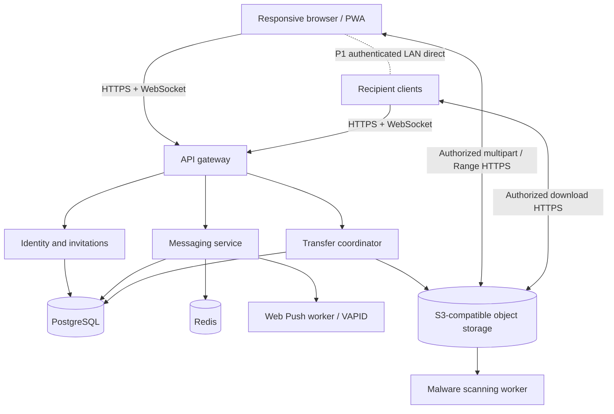
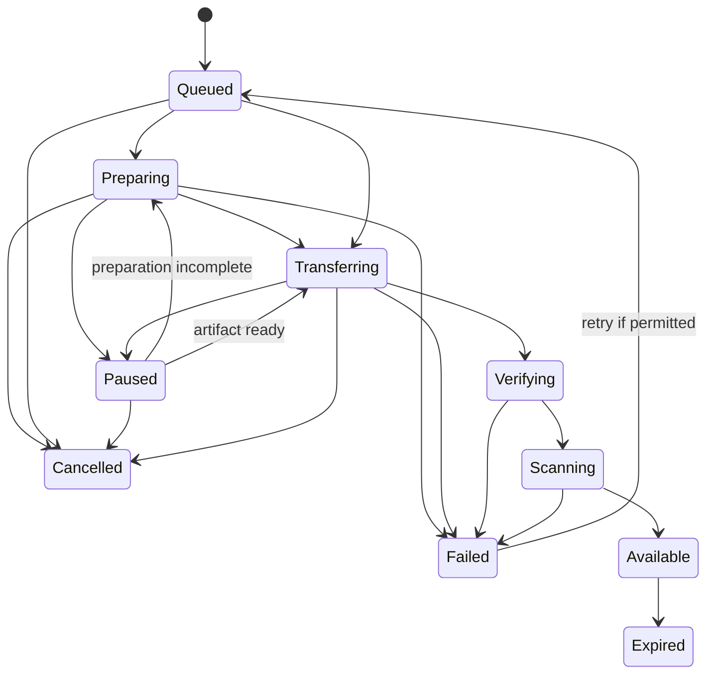
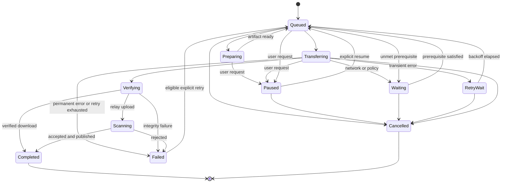

# Product Requirements Document — QR Chat & File Share

| Field | Value |
|---|---|
| Version | 1.4 |
| Date | 2026-11-24 |
| Status | Draft for engineering review |
| Product name | QR Chat (working title) |
| Platforms | Responsive web app / optional PWA on desktop and mobile |
| Deployment | Cloud or self-hosted |

## 1. Executive summary

Build a web-first Telegram-inspired messaging application that enables users to establish trusted connections by scanning QR codes, exchange messages, and share files across Wi-Fi and cellular networks. Internet-mediated transfers must work even when devices are on different networks or behind carrier-grade NAT. An optional local-network fast path reduces internet bandwidth usage when both devices are reachable on the same LAN.

The product is independently branded and does not require Telegram accounts, APIs, or infrastructure.

## 2. Goals and non-goals

- Provide simple QR-based contact, group and temporary file-sharing invitations.
- Support reliable large-file transfers, offline recipients and interrupted connections.
- Give users explicit control over mobile data, downloads, storage and privacy.
- Support self-hosting without mandatory proprietary infrastructure, except platform push services where required.
- Non-goals for MVP: voice/video calls, public channels, bots, federation, anonymous public file hosting, Bluetooth transfers and guaranteed background execution on mobile operating systems.

## 3. Personas and user stories

| Persona | User story |
|---|---|
| Individual | Scan a friend's QR code and start a private chat without sharing a phone number. |
| Traveller | Send a large video over 5G to a recipient on Wi-Fi. |
| Team member | Join a private group via an expiring QR invitation and exchange documents. |
| Nearby user | Transfer a large file over the same Wi-Fi without uploading its bytes to cloud storage. |
| Administrator | Deploy, monitor and enforce quotas on a private instance. |

## 4. Scope and priorities

P0 = MVP release blocker; P1 = next release; P2 = future.

| ID | Requirement | Priority |
|---|---|---|
| FR-01 | Account registration, login, logout and device sessions | P0 |
| FR-02 | QR contact and group invitations | P0 |
| FR-03 | One-to-one and private group messaging | P0 |
| FR-04 | Internet-based resumable file transfer over Wi-Fi and cellular | P0 |
| FR-05 | Offline delivery, push notifications and message synchronization | P0 |
| FR-06 | Mobile-data preferences, quotas, progress and cancellation | P0 |
| FR-07 | Blocking, reporting, invitation revocation and admin controls | P0 |
| FR-08 | Temporary QR file-sharing sessions with authenticated recipients | P0 |
| FR-09 | Direct LAN transfer with relay fallback | P1 |
| FR-10 | End-to-end encrypted private chats and attachments | P1; required before marketing as E2EE |
| FR-11 | Optional advanced integrations (native apps out of scope) | P2 |
| FR-12 | Internet P2P via WebRTC ICE/STUN/TURN | P2 |

| FR-13 | Original, lossless and selectable media compression | P0 |
| FR-14 | Custom encoding and adaptive compression recommendations | P1 |
| FR-15 | Transfer queue, storage preflight and batch controls | P0 |
| FR-16 | Search, mute, archive, forwarding and attachment history | P0 |
| FR-17 | Optional browser guest sharing with scoped grants | P1 |
| FR-18 | Folder sharing (P0); advanced transfer scheduling (P1) | Mixed |

| FR-19 | Responsive browser UI, accessible navigation and no-install onboarding | P0 |
| FR-20 | Installable PWA, offline shell and capability-aware Web Push | P0 (push/install where supported) |

| FR-21 | Automatic ZIP/7z archive creation and selectable levels | P0 |
| FR-22 | Universal permission-aware search and metadata indexing | P0 |

## 5. Functional requirements

### 5.1 Identity and sessions

- Support email/password or passkeys; phone number optional. Verify email before unrestricted invitations.
- Use immutable user IDs and unique usernames; allow editable display names and avatars.
- Store refresh credentials in OS secure storage; rotate refresh tokens and revoke individual device sessions.
- Provide account deletion, active-device list and privacy settings.

### 5.2 QR invitations

Provide three invitation types: contact request, private group membership and temporary file-sharing session.

1. Sender selects invitation type, expiry and permitted uses.
2. Backend generates a cryptographically random opaque token (at least 128 bits of entropy) and stores only its hash with scope, issuer, expiry and usage limits.
3. App displays a QR encoding an HTTPS universal/app link such as `https://chat.example.com/i/<token>`.
4. Recipient scans using the browser camera or device camera; the HTTPS invitation opens directly in the responsive web app. Installation is never required. Preserve the invitation through authentication.
5. Recipient reviews issuer, invitation type and requested action, then explicitly accepts. Contact requests require issuer approval unless explicitly pre-authorized.
6. Backend atomically validates expiry, revocation, usage count, identity and permissions before granting access. Scanning alone never grants membership or downloads files.

Default contact/file invitations: 15 minutes, single use; group invitations: 24 hours, configurable use count. Group administrators may revoke links. Revocation blocks new redemption, not existing memberships unless separately removed. QR tokens must not contain credentials, personal information or storage URLs. Redact tokens from logs and analytics; prevent link previews from consuming invitations.

### 5.3 Messaging

- Real-time text, emoji, replies, reactions and attachments; conversation list with unread counts.
- Private groups with owner/admin/member roles; MVP target 100 members per group.
- Delivery states: queued, sent (server accepted), delivered (recipient device acknowledged), read (subject to privacy setting), failed.
- Persist client-generated message IDs for idempotency. Use server-assigned per-conversation sequence numbers and cursor-based synchronization.
- Queue outgoing messages offline; reconnect with exponential backoff and jitter. Recover missing events after reconnect.
- Allow message editing/deletion subject to policy; display edited status. Deletion cannot retract copies already saved by recipients.

### 5.4 File sharing

- Support arbitrary file types subject to policy; default maximum 2 GiB/file, configurable by administrator.
- Select multiple files; display filename, size, progress, speed, estimated remaining time and transfer state.
- Use multipart uploads with configurable chunk size (default 16 MiB), bounded concurrency (default 3), retry per part and persistent upload state.
- Verify SHA-256 integrity after assembly; use provider-supported part checksums. Do not treat multipart ETags as SHA-256.
- Authorize each upload/download against conversation membership or file-session grant. Issue short-lived signed storage URLs only after authorization.
- Keep files available for offline recipients according to retention policy (default 30 days); display expiry and allow explicit deletion.
- Support HTTP Range downloads with persistent partial-file state and validator checks; restart if object version changes.
- Quarantine uploaded files until malware scanning completes; show safe metadata and never auto-execute attachments. For future E2EE files, server-side plaintext scanning is unavailable; disclose this and use endpoint protections.
- MVP temporary file sessions require authenticated participants and explicit acceptance. Session owner can revoke future access; downloaded copies cannot be revoked.

### 5.5 Network and background behavior

| Scenario | Required behavior |
|---|---|
| Both devices on same Wi-Fi | P0 internet relay; P1 attempt authenticated LAN direct path when reachable |
| Different Wi-Fi networks | Internet relay |
| Wi-Fi to cellular | Internet relay; respect sender and recipient data settings |
| Cellular to cellular | Internet relay; no inbound public IP required |
| Wi-Fi to 5G during upload | Reconnect, refresh expired URLs and resume missing parts if policy permits |
| Internet lost | Pause relay transfers; resume when connectivity returns |
| Same LAN without internet | Experimental P2 only; requires a validated offline signaling and trust flow, not guaranteed by browser APIs |
| AP isolation/firewall | Fall back to internet relay if available |

- Settings: Wi-Fi only, Wi-Fi + cellular, roaming opt-in, auto-download by media type/size, and per-transfer override.
- Default: no automatic large-file download over cellular; prompt before a manual cellular transfer above 100 MiB. Pause on prohibited network changes.
- All platforms use browser foreground transfers; background execution is best effort. Persist transfer IDs, completed parts and artifact identity in IndexedDB; reconcile with server on return. If file access is lost, request reselection and verify identity before resuming. Never promise uploads while the tab is closed or phone locked.

### 5.6 Compression and original-quality sharing (FR-13/14)

The attachment composer must offer a per-file and batch compression selector before upload. Default to Original for every file; users may explicitly save a media preference. Never silently degrade quality or change a selected mode when the network changes.

| Mode | Priority | Contract |
|---|---|---|
| Original / no compression | P0 | Exact original bytes, filename and embedded metadata; no re-encoding |
| Lossless | P0 | ZIP/Deflate wrapper; decoded file SHA-256 must equal source SHA-256 |
| High quality | P0 | Images up to 2560 px longest edge, JPEG quality 90; video up to 1080p, H.264/AAC |
| Balanced | P0 | Images up to 1600 px, JPEG quality 80; video up to 720p, H.264/AAC |
| Maximum | P0 | Images up to 960 px, JPEG quality 65; video up to 480p, H.264/AAC |
| Custom | P1 | Supported resolution, quality, bitrate, format and audio settings |
| Automatic recommendation | P1 | Suggest a mode based on estimated savings, network, battery and user preference; confirm before encoding |

Presets are initial targets, not guaranteed quality or size. Never upscale. Initial video target bitrates: 5, 2.5 and 1 Mbps respectively, adjusted for source frame rate and complexity; audio AAC 128/96/64 kbps. Preserve aspect ratio, orientation, audio/video sync and duration. Avoid silently dropping HDR, transparency, animation, subtitles or audio tracks; offer Original or an explicit compatibility conversion warning. Documents, executables, archives and unknown formats support Original and lossless only. P1 may add Zstandard with interoperable decoding and versioned format negotiation.

- Show source size, estimated output size/range, savings, quality/resolution, format, metadata policy and actual size after preparation. Offer preview for supported media. If output is larger, recommend Original and ask before switching. Already compressed media/archives may yield negligible savings.
- Compress on the sender device before upload; do not upload the original merely to compress it on the server unless the user explicitly opts into the fallback in section 22. Use Web Workers, bounded streaming and WebCodecs where supported; use vetted WASM codecs only within resource budgets. Unsupported platforms must offer Original rather than pretend to compress.
- Lossy modes remove location metadata by default and disclose other metadata changes. Original preserves metadata; optional metadata removal is a separate transformation and must not be labeled Original. Preserve source files and never overwrite them.
- Preflight free space for source staging, output and partial downloads; enforce source and encoded size limits independently (2 GiB default each), decoded size and quota. Use bounded buffers and limit concurrent encoding jobs (default one on mobile). Pause/defer encoding for thermal or low-battery conditions where OS signals permit.
- Show Preparing/Compressing progress, cancellation and recoverable errors. Persist completed encoded artifacts privately for resume; if an interrupted encoder cannot resume, restart preparation. Never regenerate a different byte stream under the same upload ID. Clean temporary files on cancellation, expiry, logout and completion when no longer needed.
- Record source hash, transmitted artifact hash, decoded hash for lossless, mode, codec, MIME, sizes and preset version. For lossy output verify transmitted bytes, not equality to the original. For lossless verify both wrapper and extracted bytes; use safe extraction with path traversal, symlink, nesting, expansion ratio and decompressed-size limits. Reject unsafe archives; do not automatically extract arbitrary user-supplied archives.
- Recipient sees Original/Lossless/Compressed label, actual download size and available output format. Lossless wrapper can be restored to original bytes on supported clients; lossy output cannot recover the original. Optional send-both creates two separately authorized attachments and requires explicit quota/bandwidth confirmation.
- Compression precedes encryption in future E2EE mode; avoid compressing attacker-controlled data together with secrets. Scan plaintext archives with bounded extraction in P0; E2EE endpoint checks are separate. No cross-user content deduplication or hash existence oracle.

### 5.7 Transfer management and chat completeness

- Unified upload/download queue with per-item and batch pause, resume, cancel, retry, priority, failure reason and history. Limit concurrent transfers (default 3 uploads and 3 downloads per device); use backoff with jitter and bounded retries. Distinguish waiting for Wi-Fi, storage, recipient, scanning and authentication from failures.
- Support metered Wi-Fi/hotspots, VPN, captive portals, IPv6-only/NAT64 and roaming where detectable. Unknown network cost defaults to conservative behavior. Offer per-transfer cellular permission, daily data budget and Wi-Fi-only background auto-download; never override policy silently. Estimate actual payload plus overhead and track bytes sent including retries.
- Support OS share sheet, camera/gallery, document picker, drag/drop on web, multi-select and save/export to user-selected destinations. Handle revoked file permissions, deleted sources, duplicate filenames, Unicode names and low storage. Never overwrite without confirmation. P1 folder sharing preserves safe relative paths; no absolute paths or traversal.
- Chat search (universal search as specified in section 23; local search for E2EE), pinned messages, mute, archive, forwarding with access checks, attachment gallery and notification preferences. Support typing indicators and presence with privacy controls; no phone number disclosure by default.
- Device synchronization includes message edits/deletions, receipts and membership changes; transfer progress is device-specific. Provide local cache size controls, clear-cache without deleting remote messages, and explicit retention indicators.
- QR UX includes image/gallery scanning, copy/share invite link, manual short-code entry with rate limiting (if implemented), camera permission fallback and accessible confirmation. Never open arbitrary QR URLs automatically. Show verified issuer and session scope; group removal revokes future file access subject to signed URL TTL.
- P1 guest browser mode uses an expiring scoped session after explicit sender approval, no account-wide access, rate limits and revocation. No anonymous public upload links. P1 scheduling permits charging/Wi-Fi-only transfers. Direct LAN and E2EE remain P1 unless product owner promotes them before development.

## 6. Architecture

### 6.1 Recommended stack

| Layer | Proposed technology |
|---|---|
| Frontend | React + TypeScript + Vite; responsive CSS; optional PWA |
| Browser storage | IndexedDB; OPFS where supported; service worker for app shell |
| Backend | Go or NestJS; select one during technical spike |
| API | REST/OpenAPI + WebSocket events |
| Database | PostgreSQL |
| Ephemeral state | Redis; not the source of truth for messages |
| Object storage | S3-compatible storage (managed or self-hosted) |
| Background jobs | Durable queue / transactional outbox |
| Local discovery (P1) | WebRTC ICE with authenticated signaling; no raw mDNS or socket discovery assumed |
| Observability | OpenTelemetry, Prometheus, Grafana |
| Deployment | Docker Compose for small installations; Kubernetes for HA |

Use a modular monolith initially; split services only when justified by scale. Serve all internet traffic through TLS. Object storage endpoints must be reachable by clients, with private buckets and scoped signed URLs.

### 6.2 Transfer path selection

P0 always uses durable object-storage relay. P1 attempts local direct transfer only if both clients consent, are online, have a valid authorized session and can establish an authenticated encrypted connection. Use WebRTC DataChannel with DTLS and authenticated signaling binding peer identity to session credentials; verify ICE path before labeling it direct. Discovery does not imply trust. If the LAN path fails, ask for consent before relay fallback if it would upload previously local-only data or incur cellular costs. Maintain a verified chunk manifest and transfer ID; reuse verified chunks only where the selected protocol supports it, otherwise restart the affected stage. Direct-only transfers do not provide offline delivery or cloud history of file bytes.

## 7. Data model

| Entity | Key fields |
|---|---|
| User | id, username, verified_email, status |
| Device | id, user_id, public_key, push_token, revoked_at |
| Conversation | id, type, owner_id, next_sequence |
| Membership | conversation_id, user_id, role, joined_at |
| Message | id, client_id, conversation_id, sender_id, sequence, body, timestamps |
| Invitation | id, token_hash, issuer_id, scope, expires_at, max_uses, used_count, revoked_at |
| File | id, owner_id, object_key, size, sha256, scan_status, expires_at, source_size, source_sha256, decoded_sha256, compression_mode, codec, mime, preset_version, original_name |
| Transfer | id, file_id, sender_id, session_id, upload_id, state, bytes_verified, network_policy, retry_count, artifact_version |
| DeviceTransfer | device_id, file_id, direction, state, bytes_verified, validator, updated_at |
| TransferPart | transfer_id, part_number, checksum, size, status |
| FileGrant | file_id, principal_id, scope, expires_at, revoked_at |
| Receipt | message_id, user_id, delivered_at, read_at |

Enforce foreign keys, unique client message IDs per sender, unique invitation token hashes and indexes on conversation sequence and expiry. Store file bytes outside PostgreSQL.

## 8. API contract (initial)

All protected routes require authenticated sessions. Mutating retryable operations accept idempotency keys. Return structured errors with code, message and request ID.

| Method | Endpoint | Purpose |
|---|---|---|
| POST | /v1/auth/login | Authenticate |
| POST | /v1/auth/refresh | Rotate session token |
| POST | /v1/invitations | Create QR invitation |
| POST | /v1/invitations/inspect | Preview invitation without consuming it |
| POST | /v1/invitations/redeem | Accept invitation |
| DELETE | /v1/invitations/{id} | Revoke invitation |
| POST | /v1/conversations | Create conversation |
| GET | /v1/conversations/{id}/messages?after= | Synchronize messages |
| POST | /v1/conversations/{id}/messages | Send message |
| POST | /v1/transfers | Initialize authorized upload |
| POST | /v1/transfers/{id}/parts | Request scoped part URLs |
| GET | /v1/transfers/{id} | Reconcile progress |
| POST | /v1/transfers/{id}/complete | Verify and finalize upload |
| DELETE | /v1/transfers/{id} | Cancel and schedule cleanup |
| POST | /v1/files/{id}/download | Authorize download URL |
| GET | /v1/events | WebSocket upgrade |

Upload initialization accepts compression mode, source and artifact sizes/hashes, MIME and preset version; server validates limits and immutable artifact identity. Download response includes encoding metadata and authorized artifact checksum. Add `GET /v1/conversations/{id}/search`, `GET /v1/transfers`, `PATCH /v1/transfers/{id}` for queue controls and `GET /v1/capabilities` for negotiated limits and supported formats.

Events: `message.created`, `message.updated`, `receipt.updated`, `transfer.updated`, `file.available`, `invitation.revoked`. Events carry unique IDs and resource versions; clients deduplicate and resync after gaps.

## 9. UX and transfer states

Screens: onboarding, login, chat list, conversation, contacts, QR scanner, invitation preview, QR generator, file picker, transfer manager, group settings, data/storage settings and device/security settings.

Download state is tracked separately per recipient/device: queued, downloading, paused, verifying, complete, failed or cancelled. Local direct transfers use endpoint verification and do not enter server scanning. Show accessible text labels, not color alone; support dark mode and screen readers.

## 10. Security and privacy

- TLS 1.2+ (prefer 1.3), encryption at rest, managed secrets, least privilege and private storage buckets.
- Enforce object-level authorization on every resource; test cross-user and cross-group access.
- Rate-limit login, invitation inspection/redemption, message sending and uploads. Block/report abuse and enforce user/storage quotas.
- Short-lived access tokens and signed URLs; revocation prevents new URL issuance, while previously issued URLs may remain valid until expiry. Use short TTLs and proxy downloads if immediate revocation is required.
- No message bodies, QR tokens or signed URLs in operational logs. Push payloads should avoid sensitive content by default.
- P0 server-mediated messages are not E2EE; operators with sufficient access may read content. P1 E2EE requires reviewed protocols/libraries, device verification, key rotation, multi-device key distribution, encrypted attachments and an explicit backup/recovery design. Do not invent cryptographic protocols.
- Document data export/deletion, backup expiry, retention, breach response and applicable privacy obligations (including Singapore PDPA where applicable).
- Threat model: stolen QR links, replay, malicious files, account takeover, unauthorized storage access, LAN impersonation, denial of service and metadata leakage.

### 10.1 Additional security and operational gates

Require account recovery and session revocation tests, admin MFA, dependency/SBOM scanning, signed releases, secret rotation, audit logs for administrative actions, and tenant isolation if multi-tenancy is enabled. Validate MIME by content; sandbox media parsers and archive scanners with CPU, memory and time limits. Serve risky files as attachments with safe content headers; isolate previews from the application origin. Apply CSRF protection for cookie sessions, restrictive CORS/CSP, and WebSocket authorization on reconnect and membership change. Support report/block workflows and documented abuse response. Do not claim Telegram compatibility or E2EE for P0. For privacy-first deployments, promote reviewed E2EE to P0 and redesign search, scanning, recovery and key management before implementation.

## 11. Non-functional requirements and targets

Targets are proposed, not measured guarantees.

| Metric | Initial target |
|---|---|
| Concurrent connected clients | 1,000 per reference deployment |
| Messaging throughput | 100 messages/sec sustained in load test |
| Message delivery | p95 under 1 second to online recipient, regional test with RTT <=100 ms |
| API latency | p95 under 300 ms excluding file bytes and external dependencies |
| Availability | 99.9% monthly for HA production deployment |
| File integrity | 100% checksum match for completed transfers |
| Transfer recovery | Resume within 15 seconds after stable allowed connectivity, foreground reference test |
| Backup recovery | RPO <= 15 minutes; RTO <= 4 hours for HA deployment |
| Accessibility | WCAG 2.2 AA target across responsive web views |

Load test mixed messaging and transfers; measure storage throughput, API saturation and mobile memory. File bytes must not be buffered in full by API or clients.

## 12. Infrastructure and cost model

Reference pilot (not a production sizing guarantee): API/worker 4 vCPU/8 GiB RAM, PostgreSQL 4 vCPU/8 GiB RAM, Redis 2 vCPU/2 GiB RAM, and independently scalable object storage. Production HA requires redundant API replicas, database failover, durable storage, backups and tested restoration. Expose HTTPS/WSS on TCP 443; keep database, cache and management ports private. LAN direct port requirements are defined during P1 spike.

Example: 100 daily active users x 2 files/day x 100 MiB = 19.53 GiB uploaded/day. With 30-day retention, steady-state logical storage is about 586 GiB, excluding replicas, versions and incomplete uploads. One download per upload adds approximately 586 GiB monthly download traffic. Group fan-out multiplies egress by actual recipient downloads. Enforce lifecycle cleanup for abandoned multipart uploads and expired objects. Set default user quota to 10 GiB, adjustable by admin.

## 13. Acceptance tests

| ID | Test | Pass condition |
|---|---|---|
| AT-01 | Scan valid contact QR | Correct issuer preview; explicit acceptance; no duplicate contact |
| AT-02 | Expired/revoked QR | Rejected without granting access |
| AT-03 | Concurrent single-use redemption | Exactly one successful redemption |
| AT-04 | Group QR | Correct role assigned; unauthorized admin actions denied |
| AT-05 | 2 GiB transfer Wi-Fi to cellular | Complete with matching SHA-256 under allowed policy |
| AT-06 | Cellular to cellular behind CGNAT | Relay transfer completes without port forwarding |
| AT-07 | Switch Wi-Fi to 5G mid-upload | Missing parts resume; completed parts not unnecessarily resent |
| AT-08 | Wi-Fi-only policy | Transfer pauses on cellular; resumes on Wi-Fi |
| AT-09 | App restart mid-transfer | Persisted state reconciles; resume or explain OS/file-access limitation |
| AT-10 | Offline recipient | File and message available after reconnect within retention |
| AT-11 | Duplicate message retry | One stored message and one visible message |
| AT-12 | Unauthorized file ID | Access denied; no signed URL issued |
| AT-13 | Corrupt part or file | Integrity failure detected; file not marked available |
| AT-14 | Malware test file | Quarantined; recipient cannot download |
| AT-15 | Cancellation and expiry | Access denied per policy; abandoned storage cleaned |
| AT-16 | LAN direct (P1) | Authorized peers transfer verified bytes without cloud file upload |
| AT-17 | LAN isolation (P1) | Relay fallback with required consent or clear failure |
| AT-18 | E2EE (P1) | Server cannot decrypt content; independent security review completed |
| AT-19 | Load and recovery | Meet section 11 targets under documented test conditions |

| AT-20 | Original transfer | Source and received SHA-256 identical, metadata unchanged |
| AT-21 | Lossless round trip | Restored bytes match source; wrapper integrity verified |
| AT-22 | All media presets | Output decodes, respects resolution limits, preserves duration and disclosed features |
| AT-23 | Unsupported format or larger output | Explicit warning and consent before fallback; no silent conversion |
| AT-24 | Cancel/restart compression | Source untouched; temporary artifacts cleaned or safely resumed |
| AT-25 | Network switch after compression | Resume identical artifact; no re-encoding or silent quality change |
| AT-26 | Low disk / battery / thermal | Safe pause or clear error, no corrupt output |
| AT-27 | Malicious archive / oversized decode | Reject safely within configured resource limits |
| AT-28 | Mixed batch and duplicate filenames | Per-file choices honored; no unintended overwrite |
| AT-29 | Metadata privacy | GPS stripped in lossy default; Original unchanged |
| AT-30 | Metered hotspot and roaming | Policy enforced, consent required where applicable |
| AT-31 | QR from gallery and revoked membership | Safe preview; revoked access denied |
| AT-32 | Search and forwarding | No unauthorized results or file access |
| AT-33 | Guest session (P1) | Scope, expiry, approval and revocation enforced |
| AT-34 | Compression resource test | Stream 2 GiB lossless input on reference device without full-file buffering or OOM |
| AT-35 | Account recovery and device revocation | Revoked sessions cannot refresh or authorize new transfers |

Test desktop Chrome/Edge/Firefox/Safari and Android Chrome/Firefox and iOS Safari, including installed PWA mode, IPv4/IPv6, carrier NAT, hotspot, packet loss, low storage, expired credentials, roaming and background restrictions. Use synthetic files and test accounts.

## 14. Delivery plan

Indicative schedule for a small experienced cross-functional team; re-estimate after discovery.

| Phase | Duration | Deliverables |
|---|---|---|
| Discovery | 1–2 weeks | UX flows, threat model, browser transfer and codec spikes |
| Foundation | 2–3 weeks | Auth, database, CI/CD, deployment, observability |
| Messaging and QR | 3–4 weeks | Chats, groups, invitations, offline sync |
| File transfer | 3–4 weeks | Multipart, download resume, compression presets, queue, policies, scanning |
| Hardening and beta | 2–3 weeks | Device tests, load/security tests, recovery drills |
| P1 | Re-estimate separately | LAN direct, reviewed E2EE, guest sessions and custom compression |

MVP exit gate: all P0 acceptance tests pass, no unresolved critical/high security findings, backup restoration tested, deployment/runbooks documented, and mobile data controls verified on real devices.

## 15. Success metrics

Measure QR acceptance rate (target >=90% for valid intentional scans), successful eligible file transfers (>=99%), resume success (>=95% under supported conditions), time to first chat, duplicate-message rate, transfer failure reasons, storage cost per active user and user-reported issues. Exclude explicit cancellations and policy-denied transfers from reliability denominators and report them separately. Collect privacy-preserving telemetry only.

## 16. Risks and open decisions

| Risk / decision | Mitigation or next step |
|---|---|
| Mobile OS background restrictions | Browser lifecycle and storage spike and explicit UX for paused tasks |
| CGNAT and network isolation | Durable relay baseline; no dependency on inbound ports |
| Storage/egress growth | Quotas, retention, monitoring and optional LAN direct path |
| QR abuse | Scoped expiring tokens, confirmation, rate limits and revocation |
| E2EE vs scanning and recovery | Decide whether E2EE must be promoted to P0 before implementation |
| Guest sharing | P1 scoped browser sessions; excluded from MVP |
| Identity provider | Choose passkey/email implementation and account recovery policy |
| Hosting | Choose single-tenant vs multi-tenant and storage region |
| File limits | Validate 2 GiB default against device/storage tests and business needs |
| Offline LAN onboarding | P2 feasibility spike; offline signaling and trust not included in P1 baseline |

## 17. Definition of done

Each requirement has automated or documented manual tests, reviewed implementation, telemetry, security checks, accessibility review where relevant, and updated API/deployment documentation. Release artifacts include source code, OpenAPI specification, database migrations, Docker Compose configuration, environment template without secrets, test report, threat model and operator runbook.

## 18. Implementation decisions and release gap checklist

- Recommended MVP stack: React/TypeScript/Vite PWA, Go modular monolith, PostgreSQL, Redis and S3-compatible storage. Validate browser codecs, storage and lifecycle limitations before locking dependencies. Review codec licensing and platform distribution obligations.
- CI/CD: unit, integration, API contract, end-to-end, migration, dependency and container scans; separate dev/staging/prod; rollback and feature flags for codecs and LAN. Test storage provider multipart/Range compatibility.
- Reference support matrix: Android 10+, iOS 16+, current and previous major Chrome/Safari/Firefox versions; confirm against actual browser capabilities at release. Publish capability differences rather than claiming parity.
- Observability: preparation duration, compression ratio by mode/file type, CPU/memory, temporary disk, retry bytes, queue age, scan latency and transfer success by network class. Do not collect filenames, hashes or content in analytics.
- Cost model: transmitted payload = source bytes × measured compression ratio; storage savings depend on retained variants, replication and retention. Example 850 MB to 350 MB saves 500 MB (58.8%) per upload and per recipient download, excluding overhead; not a guaranteed codec outcome.
- Operational readiness: alert on stuck jobs, orphaned multipart uploads, quota saturation, failed scans and backup failures; test restore of both metadata and object bytes, including deletion/retention reconciliation.
- Product owner decisions before sprint 1: whether LAN without internet and E2EE are mandatory at launch; account recovery method; retention and file limits; guest access; supported codecs; deployment tenancy and data residency. Default to relay MVP, authenticated users and Original mode.
- Release sequencing: include Original and lossless in the first transfer vertical slice; add lossy presets before MVP exit; custom and adaptive modes in P1. Re-estimate schedule after codec/background spikes; prior schedule excludes the added scope.

## 19. Web-first responsive product requirements

### 19.1 Layout and interaction (P0)

- Mobile below 768 CSS px: single-panel chat list or conversation, back navigation, bottom-sheet attachment/compression picker, safe-area padding and keyboard-aware composer. Tablet 768–1023 px: two panels when space permits. Desktop 1024–1439 px: chat sidebar and conversation; 1440+ px: optional details panel. Use container queries where useful; support 320 px width, landscape and 200% zoom without horizontal page overflow.
- Desktop drag/drop, paste and multi-file picker; mobile file picker, photo library and camera where supported. Folder selection is progressive enhancement. Preserve drafts, scroll position and active transfer state on resize/navigation. Virtualize long message lists; accessible keyboard navigation, focus management, live progress announcements, reduced motion, dark/light theme and 44 px preferred touch targets.
- Routes: /login, /invite/:token, /chats, /chats/:id, /transfers, /settings, /admin (authorized only). Browser back/forward and direct links must work. QR generation supports copy link, download image and camera/gallery scan; use a decoder fallback where BarcodeDetector is absent. Camera requires HTTPS and permission; manual link entry always available.

### 19.2 Browser transfer and compression contracts (P0)

- HTTPS multipart uploads via bounded Blob slices and XMLHttpRequest progress or equivalent; use server-authoritative part reconciliation, retry backoff and idempotency. Configure storage CORS for explicit origins, required methods/headers and exposed ETag. Downloads use Range where supported; browser-native download fallback may not provide app-level pause/resume. Never buffer a 2 GiB file in JS memory. Stream hashing in a worker; persist compressed artifacts in OPFS where available or require safe reselection/repreparation when unavailable. Do not claim resume if identical artifact bytes cannot be recovered.
- Original mode always available; lossless streaming ZIP and supported image/video presets remain requirements. Feature-detect WebCodecs, supported encoders and storage; unsupported media shows explicit Original fallback with consent. No hidden server-side lossy processing. Validate Safari memory constraints and codec licensing. Do not silently reduce quality.
- Network Information API is not universal and cannot reliably identify roaming, metered Wi-Fi or cellular on every browser. Display unknown network state; when Wi-Fi-only or strict budget policy is enabled, fail closed on unknown unless the user explicitly overrides. Recheck available signals during transfer; explain that browser-only policy cannot guarantee detection of every network change. Online/offline events are hints; actual request failures drive retries.
- Tab closure, OS suspension, screen lock and browser storage eviction may interrupt transfers. Persist checkpoints; resume on reopening with permission and file identity validation. Warn before navigating away during active transfers where browser permits. Coordinate multiple tabs via Web Locks/BroadcastChannel where available and server-side idempotency everywhere.

### 19.3 PWA, security and deployment

- Web manifest, icons, standalone display and service worker; optional installation only. Cache versioned static shell, not private API responses, invitation URLs or attachment bytes by default. Offline UI shows connection state and queued drafts; purge account-scoped local data on logout. Handle service worker updates without interrupting active transfers.
- Web Push via VAPID and service worker, opt-in after user action; iOS support depends on installed home-screen web app and supported OS. In-app notifications remain baseline. No dependency on native push SDKs. Push payloads omit sensitive message contents by default.
- Secure HttpOnly/SameSite cookies, CSRF defenses, strict CSP, output escaping, origin validation for WebSocket, rate limits, HTTPS and no third-party scripts on invitation routes. Exchange invite token for scoped grant and remove token from URL/history where practical; no-referrer policy and no token logging. Do not render untrusted HTML/SVG inline; isolate previews. Service worker scope restricted to app origin.
- Deploy static frontend and API behind HTTPS reverse proxy with WebSocket upgrades, suitable timeouts and SPA route fallback; object storage direct signed HTTPS transfers. Docker Compose baseline includes frontend, API, worker, PostgreSQL, Redis and S3-compatible storage. No native build, app store or Flutter dependency.
- P1 direct LAN uses WebRTC DataChannel with bounded chunks and backpressure, authenticated online signaling and consent-based relay fallback. TURN relay is not LAN direct. Browser cannot guarantee local discovery, offline peer connection or network-interface selection. Fully offline LAN is P2 research; both peers must remain active for direct transfer.

### 19.4 Additional acceptance tests

| ID | Test | Pass condition |
|---|---|---|
| AT-36 | Responsive layout | 320, 375, 768, 1024 and 1440 CSS px; no clipped controls or lost drafts |
| AT-37 | Mobile keyboard and rotation | Composer visible; transfer and navigation state preserved |
| AT-38 | QR browser onboarding | Camera, gallery and manual link paths work without installation; denied permission has fallback |
| AT-39 | Browser reload or tab termination | Server parts reconciled; reselect verified file if required; no duplicate message |
| AT-40 | Unknown network | Strict Wi-Fi policy blocks until explicit override; no false network claim |
| AT-41 | Unsupported codec or storage | Clear fallback; no silent lossy conversion or full-file memory buffering |
| AT-42 | PWA offline and update | Shell loads offline; private cache policy enforced; active transfer not disrupted by forced update |
| AT-43 | Web Push unavailable | In-app notification fallback; iOS install requirement explained |
| AT-44 | Multi-tab concurrency | No duplicate upload completion or message; state reconciled |
| AT-45 | Accessibility | Keyboard, screen reader, contrast, zoom and touch checks pass |
| AT-46 | Cross-origin and security | CORS, CSRF, CSP, WebSocket origin and invite token leakage tests pass |
| AT-47 | Browser compatibility | Real desktop and mobile browser matrix passes P0; capability limitations documented |
| AT-48 | Large-file browser test | 2 GiB original transfer on reference browsers with bounded memory and verified checksum |

AT-08, AT-26 and AT-30 apply to detectable network/resource signals; unsupported signals require explicit warnings and strict-policy fallback. AT-16/17 remain P1 online-signaled direct transfer tests. All P0 web tests are MVP release gates; optional capabilities require tested fallback rather than universal browser parity.

## 20. Advanced transfer manager and durable queues (P0)

This section extends FR-04, FR-06 and FR-15 and takes precedence over earlier simplified transfer-state descriptions. Applies to desktop and mobile web, uploads and downloads, individual files and batches, original and compressed artifacts. Direct WebRTC transfers inherit these controls when introduced.

### 20.1 User interface and controls

- Dedicated `/transfers` page and persistent global transfer indicator with active count, aggregate progress and actionable errors. Desktop uses a collapsible panel; mobile uses a full-screen view or bottom sheet. Chat navigation never cancels a transfer.
- Tabs: All, Uploads, Downloads, Active, Queued, Paused, Completed, Failed. Search by filename and conversation; sort by date, size, priority or status. Show filename, direction, peer/chat, original and transfer sizes, compression mode, verified bytes, percentage, smoothed speed, ETA (unknown when stalled), retry countdown and blocking reason.
- Per-item actions: pause, resume, retry, cancel, move up/down, set priority, open conversation and inspect error. Batch actions: select all filtered items, pause all, resume all eligible, cancel selected (confirmation), retry failed, clear completed history. Clearing history never deletes chat attachments. Keyboard-accessible reorder controls are mandatory; drag/drop is optional.
- Pause stops scheduling new chunks and aborts in-flight requests where safe. A chunk may finish concurrently; reconcile server acknowledgments before showing stable progress. Manual pause survives refresh, reconnect and browser restart; never auto-resume manually paused jobs. Resume All is explicit user consent but does not bypass network, storage, authorization or quota gates.
- Cancel is terminal for that job, aborts requests and schedules partial cleanup; restarting creates a new job. Sender cancellation before publication prevents delivery. Recipient cancellation affects only that device's download. Deleting a published attachment is a separate authorized action.
- Queue files while offline or while slots are full. Allow sending text and preparing other files during transfers. Display individual and batch outcomes; partial batch failure never rolls back successful files. A queued attachment placeholder is visible to sender only until authorized publication; caption and message order remain stable.

### 20.2 Scheduler and policies

| Setting | Default / contract |
|---|---|
| Concurrent uploads/downloads | 3 each per device; configurable 1–5; mobile resource pressure may reduce effective limit |
| Compression workers | 1 per device by default; independent from network slots |
| Priority | High, Normal, Low; FIFO within priority; aging prevents starvation |
| Reordering | Applies to waiting jobs; no implicit interruption of active jobs |
| Chunk size | Default 8 MiB; negotiate storage limits; bounded parallel chunks (default 2 per job) |
| Retry | Transient errors: exponential backoff with jitter, 1–60 seconds, maximum 5 consecutive attempts; honor Retry-After |
| Auto-resume | Enabled for network interruptions in foreground when policy permits; user pause remains sticky |
| Network policy | Any network, Wi-Fi only, or ask on cellular/unknown; per-job override explicitly confirmed |
| Bandwidth cap | Optional separate upload/download caps, aggregate per device; best effort for app-managed transfers |
| Retention | Paused partial uploads retained 7 days by default, configurable; show expiry and warn before cleanup |
| Scheduling | P1 time windows and charging preference, only when browser signals/execution permit |

Use a shared scheduler across tabs; enforce server account quotas and rate limits across devices. Paused and blocked jobs release slots. Fairness applies between conversations; avoid head-of-line blocking when one job awaits storage or permission. Never promise exact bandwidth throttling for browser-native downloads. Count actual attempted network bytes including retries toward estimated data budget; disclose that OS-level billing may differ.

### 20.3 State machine and recovery

Preparing and Failed may also be cancelled; verification/scanning cancellation is best effort before atomic publication. Once published, cancellation must not masquerade as message deletion. Waiting reasons include offline, prohibited/unknown network, authentication, missing source, storage, quota and peer unavailable. Expired jobs enter Failed with an explicit restart requirement. RetryWait and Waiting can be manually paused. Pause during compression checkpoints only if codec supports it; otherwise stop and restart preparation with disclosure. Never change bytes under an existing upload ID.

### 20.4 Persistence and protocol

- IndexedDB stores account/device-scoped job ID, direction, batch ID, conversation, artifact ID/version/hash/size, state, pause intent, priority, order, policy, retry count, timestamps, acknowledged ranges, validator and error code. OPFS stores partial downloads and prepared artifacts when available; file handles are optional and permission-dependent. Do not store signed URLs or credentials in durable job records.
- Upload: reconcile multipart part numbers, sizes and checksums against server storage; retry missing or invalid parts only. Refresh expired signed URLs after authorization. Complete atomically with idempotency key; verify whole artifact SHA-256 and scan before publication. Never treat locally sent bytes as durable acknowledgments.
- Download: persist committed byte ranges and strong ETag/artifact version; use Range and If-Range, validate 206 and Content-Range. On changed validator or unexpected 200, stop and offer safe restart; never append incompatible bytes. Verify final hash before exposing completed output. Stream to supported file sink or OPFS with bounded memory. If app-managed large-file download is unavailable, offer browser-native download with explicit pause/resume limitation; no false completed status. P0 release requires tested app-managed pause/resume for reference desktop and mobile browsers within documented storage limits.
- After refresh, crash, lock or reopening, reconcile jobs before scheduling. If source permission is lost, request reselection and verify exact artifact identity; if partial bytes are evicted, explain restart requirement. Browser closure cannot guarantee continued execution. Service workers must not be relied on for long-running transfers.
- Use Web Locks or renewable local leases with fencing and BroadcastChannel; backend compare-and-set state revisions and idempotency prevent duplicate publication. Cross-device history may sync, but local file handles and partial downloads do not migrate automatically.

### 20.5 API and data additions

Extend existing transfer endpoints rather than creating conflicting upload APIs. `PATCH /v1/transfers/{id}` accepts action (pause/resume/retry/reprioritize), expected revision and idempotency key for authorized upload control; `DELETE` cancels. `GET /v1/transfers` supports cursor, direction and state filters. `POST /v1/transfers/batch-actions` returns per-item results, not all-or-nothing. Device-local download controls remain local; optional authenticated checkpoint sync must not affect other recipients. Add job/batch IDs, pause reason, priority, queue rank, revision, expiry, last error, next retry and verified byte count to transfer metadata. WebSocket events include job ID, monotonic revision and state; clients reconcile after reconnect. Reject unauthorized actions and stale revisions; no signed URLs in events or logs.

### 20.6 Acceptance tests (additional P0 release gates)

| ID | Scenario | Pass condition |
|---|---|---|
| AT-49 | Pause upload mid-chunk | Stops new requests; reconciles committed parts; releases slot |
| AT-50 | Resume upload | Only missing parts resent; final SHA-256 matches |
| AT-51 | Pause/resume download | Committed ranges retained; final checksum matches |
| AT-52 | Manual pause and reconnect | Remains paused after refresh and network recovery |
| AT-53 | Queue 20 files | Concurrency limits respected; all eligible jobs eventually run |
| AT-54 | Priority and reorder | Waiting jobs follow ordering; low priority not starved |
| AT-55 | Batch pause/resume/cancel | Correct per-item results; unrelated jobs unchanged |
| AT-56 | Wi-Fi/cellular/unknown switch | Policy enforced on detectable changes; no silent override |
| AT-57 | Retry and throttling | Backoff, Retry-After and retry limit respected |
| AT-58 | Expired URL | Reauthorize and resume without duplicate publication |
| AT-59 | Browser killed or source lost | Recover checkpoints or request verified reselection |
| AT-60 | Storage eviction or full disk | Clear blocked/restart state; no corrupt completed output |
| AT-61 | Changed download validator | Never append incompatible bytes |
| AT-62 | Two tabs racing | Single logical job and publication; revisions reconcile |
| AT-63 | Cancel during finalization | Atomic outcome; no orphan published message or false cancellation |
| AT-64 | Compressed artifact resume | Same encoded bytes; no silent recompression |
| AT-65 | Partial expiry | Visible expiry, cleanup and explicit restart path |
| AT-66 | Mobile navigation/rotation | Transfer state and controls remain accessible |
| AT-67 | Recipient cancellation | Other recipients and published attachment unaffected |
| AT-68 | Unsupported browser sink | Explicit fallback and limitations; no false progress/completion |
| AT-69 | Authorization revoked | Further access denied; no new signed URLs; local partial cleanup policy applied |
| AT-70 | Pause all while offline | Manual intent persists and no automatic restart |

Monitor queue age, verified throughput, retry bytes, resume success, stalled jobs and orphaned multipart uploads without collecting filenames or content. Target foreground pause acknowledgment within 2 seconds under normal conditions and eligible recovery within 15 seconds of stable allowed connectivity; test on real mobile and desktop browsers. Include scheduler unit tests, API race tests, Playwright flows and fault injection for disconnects, storage failures and expired credentials.

## 21. Change history

| Version | Changes |
|---|---|
| 1.0 | Baseline chat, QR invitations, relay transfers and roadmap |
| 1.1 | Selectable compression, integrity and metadata contracts, queue and network controls, chat completeness, guest roadmap, security and operational gaps, expanded acceptance tests |
| 1.2 | Web-only responsive architecture, optional PWA, browser transfer and codec constraints, WebRTC LAN roadmap, browser security and acceptance tests |
| 1.3 | Durable upload/download queues, pause/resume, priorities, batch controls, browser recovery, API concurrency and 22 additional acceptance tests |

| 1.4 | Automatic ZIP/7z, capability-aware levels, archive manifests, universal search and metadata indexing; sections 22–24 supersede conflicting earlier scope. |

## 22. Automatic archive creation (FR-21)

P0: support individual files, multiple selections and folders (relative paths where browser permits). Attachment composer offers Send individually, Auto archive, ZIP, 7z, and separate optional lossy media conversion. Original remains default unless user saves an explicit preference. Auto archive can use saved rules (file count, aggregate size, folder selection, estimated savings, network policy); show selected format and level before sending, with override. Never silently apply lossy conversion. Store mode packages files without compression and is distinct from sending originals individually.

| Level | 7z setting | Intent |
|---|---|---|
| Store | 0 | Bundle only |
| Fastest | 1 | Low preparation cost |
| Fast | 3 | Mobile-friendly candidate |
| Normal | 5 | Balanced default for archive mode |
| Maximum | 7 | Higher compression effort |
| Ultra | 9 | Highest preset effort, capability gated |

ZIP uses supported Deflate levels or Store; do not imply equal results across formats. 7z uses LZMA2 by default; LZMA and advanced dictionary/thread/solid-block options P1. TAR, TAR.GZ and TAR.ZST P1. Levels are intent, not promised output ratios. Pin encoder version and effective settings. Native 7-Zip defaults vary by version and architecture; never hardcode a universal Ultra memory requirement. Reference: https://7zip.bugaco.com/7zip/MANUAL/cmdline/switches/method.htm and https://github.com/ip7z/7zip/blob/main/DOC/src-history.txt.

### 22.1 Capability and resource policy

- Probe supported encoder, WASM memory limits, worker/thread availability, storage estimate and file access; use conservative budgets where device memory is unknown. Benchmark ZIP/7z on actual iOS Safari and Android Chrome, desktop Chrome/Edge/Firefox/Safari. Use vetted streaming-capable ZIP/7z libraries; a WASM build that buffers entire files is not acceptable for large inputs.
- Show unavailable presets with explanation, recommended alternative and estimated preparation cost. Ultra only selectable when preflight passes. On failure offer lower level, ZIP, original or explicit server processing; never silently downgrade.
- Server fallback is optional, disabled by default, consented per job or explicit saved policy; disclose full original upload, temporary storage, privacy and quotas. Disable for E2EE unless performed locally. Isolated unprivileged workers, fixed argument allowlists (no shell interpolation), resource/time limits and cancellation. Delete staging originals on completion or TTL; do not publish before verification and scan.
- Archive creation has its own persistent queue and one worker by default; pause/resume only at supported checkpoints, otherwise restart preparation with disclosure. Finished archive bytes are immutable and use existing multipart upload/resume. Show separate preparation/upload/scan progress. Enforce aggregate input, output, member count and decoded size limits; default 2 GiB aggregate input/output, configurable.
- Detect already compressed or encrypted inputs; recommend Store or individual transfer when savings unlikely. Show actual size and offer override if archive grows. Preserve original filenames and relative hierarchy, timestamps where representable, per-member SHA-256 and original metadata in a protected manifest; do not claim preservation of OS ACLs or unsupported filesystem attributes.
- Recipient can download archive, browse authorized member list and selectively download safe extracted members where supported (P0 for generated unencrypted archives; external archives subject to bounded extraction). P1 split archives, password-protected ZIP AES/7z AES and encrypted headers; never log passwords or index protected content without explicit authorized client-side processing.
- Reject absolute paths, traversal, symlinks, duplicate normalized paths, decompression bombs, unsafe nesting and excessive CPU/storage use. Never execute extracted content. Verify member hashes and archive hash before publication.

## 23. Universal search and metadata (FR-22)

### 23.1 Search experience

P0 global search across all authorized chats, groups, contacts, messages, captions, filenames, attachments, archive entries and transfer history. Tabs: All, Messages, People, Groups, Files, Media, Archives, Transfers. Search within chat or archive; keyboard shortcut Ctrl/Cmd+K; mobile full-screen search with filter sheet. Highlight matches safely, jump to message, preview authorized file/member, download or open chat. Cursor pagination, debounce, cancellation, recent searches local/clearable, date/relevance/size sorting. Never expose unauthorized names, snippets, counts, suggestions or facets.

| Indexed data | Examples | Priority |
|---|---|---|
| Messages | Text, captions, links, sender, dates, edited state | P0 |
| Files | Name, extension, MIME, size, hash (exact authorized match), tags, description | P0 |
| Transfer metadata | Status, direction, date, compression format/level, original and transmitted size | P0 |
| Archive manifest | Member name, relative path, size, timestamps, hash | P0 |
| Document content | TXT, CSV, text PDF, DOCX, XLSX, PPTX, JSON, XML, source code | P0 bounded parser support |
| Media metadata | Dimensions, duration, codec, orientation, capture time, camera model | P0 where available |
| Document metadata | Title, author, subject, keywords, page count, created/modified dates | P0 where available |
| Geospatial metadata | EXIF GPS, GeoJSON/GeoTIFF bounding box, CRS/EPSG | P1 opt-in sensitive location |
| OCR and transcripts | Scanned PDF, image text, audio/video speech | P1 opt-in |
| Semantic search | Meaning-based multilingual retrieval | P2 opt-in |

Metadata extraction is best effort; missing values are null, not invented. Track source (embedded, user-entered, derived), parser version, timezone, units and visibility. GPS and other sensitive metadata not indexed by default; original files still retain embedded data and UI warns before sharing. Allow edit of user tags/descriptions without modifying original bytes. Archive metadata never loosens parent ACL. Support Unicode normalization, CJK tokenization, case-insensitive filename matching, exact phrases, prefix matching and typo tolerance where supported.

Example queries (structured filters also available in UI):

- `type:pdf from:alice after:2026-01-01 budget`
- `ext:7z compression:ultra size:>100MiB`
- `in:project filename:report.xlsx`
- `archive:backup.7z path:docs/ contract`
- `tag:invoice status:completed`
- `camera:Vivo` or `width:>=1920`

Define typed query grammar, allowlisted operators and field-specific units; unknown fields yield helpful validation. No raw SQL or search-engine DSL from clients. Search only supported/indexed material; explain encrypted, unsupported, pending, partial or failed indexing.

### 23.2 Architecture and authorization

Use PostgreSQL full-text search plus pg_trgm and typed metadata columns/JSONB with appropriate indexes for MVP; benchmark multilingual tokenization and add OpenSearch for scale or CJK requirements if needed. Extract content asynchronously with isolated Apache Tika or equivalent format-specific parsers, EXIF/media parsers and archive workers. Outbox events on create/update/delete/membership changes feed idempotent versioned indexing jobs; stale jobs cannot resurrect deleted content. Index only scanned/authorized artifacts. Bound bytes, pages, nested depth and processing time; label truncation. Search service returns candidate IDs; authoritative ACL checks apply before any result/snippet/facet is returned. Tenant and conversation isolation, membership history policy and deletion/retention apply to all indices, caches, OCR and backups. No public hash existence oracle. No search text or extracted metadata in analytics logs.

For future E2EE, use local decrypted indices in IndexedDB/OPFS with device-specific access and deletion; no server plaintext or blind claims of equivalent cross-device results. Password-encrypted archives are not server content-indexable. P2P-only files searchable by authorized shared manifest, not server content unless explicitly provided.

### 23.3 API and data additions

- `POST /v1/archive-jobs`, `GET /v1/archive-jobs/{id}`, `PATCH /v1/archive-jobs/{id}` (pause/resume/cancel with revision), `GET /v1/files/{id}/members`, authorized member download endpoint.
- `GET /v1/search?q=&scope=&type=&cursor=&sort=`; structured filters validated server-side; `GET /v1/files/{id}/metadata`; `PATCH /v1/files/{id}/tags`; `GET /v1/files/{id}/index-status`.
- ArchiveJob: owner, input manifest, requested/effective format and preset, encoder version, execution location, state, revision, resource limits, artifact ID, expiry. ArchiveMember: artifact ID, normalized relative path, bytes, SHA-256, timestamps, MIME, scan state. SearchDocument: tenant, conversation, entity type/id/version, searchable text, typed metadata, extraction state, visibility, timestamps. IndexTask: entity/version, state, attempts, error code, next retry.
- Initial targets (validate with 100 concurrent active users and 1 million searchable entities): search p95 <= 500 ms for standard metadata/text queries; newly committed messages indexed within 5 s p95, supported documents within 120 s p95 for <=10 MiB; larger jobs show pending status. Revocation must take effect at query authorization immediately, regardless of indexing delay.

## 24. Additional acceptance criteria and release gates

| ID | Scenario | Expected outcome |
|---|---|---|
| AT-71 | Auto archive multiple files/folder | Correct selection and relative paths; explicit override |
| AT-72 | ZIP/7z Store through Ultra | Valid interoperable archives for enabled levels; hashes match originals |
| AT-73 | Ultra memory budget exceeded | Block safely and offer alternatives |
| AT-74 | Unsupported encoder on mobile | Original or supported format offered, no false success |
| AT-75 | Incompressible media | Warn of negligible savings or larger artifact |
| AT-76 | Pause/cancel archive preparation | Correct state and cleanup; restart disclosed if needed |
| AT-77 | Resume archive upload after reload | Identical artifact and acknowledged parts |
| AT-78 | Server fallback | Explicit consent, quotas and staging cleanup |
| AT-79 | Malicious archive paths/bomb | Bounded rejection and no publication |
| AT-80 | Member browse/download | Authorized entries only; verified extraction |
| AT-81 | Search message/file/content | Correct matches across supported types |
| AT-82 | Metadata filters and Unicode/CJK | Correct typed comparisons and matching |
| AT-83 | Archive member search | Parent ACL applied to every result |
| AT-84 | Membership revoked during search | No result, count, suggestion or snippet leakage |
| AT-85 | Delete/edit race and index retry | No stale resurrection; latest version wins |
| AT-86 | Unsupported/encrypted file | Clear limited-index status; no password leakage |
| AT-87 | GPS default and explicit opt-in | Sensitive fields excluded by default |
| AT-88 | Parser timeout or malformed file | Bounded failure, transfer unaffected if safe |
| AT-89 | Search mobile keyboard/accessibility | Responsive keyboard and touch navigation |
| AT-90 | Search load and indexing lag | Meets targets or blocks release pending remediation |
| AT-91 | Cross-tenant query/hash probe | No information leakage |
| AT-92 | PWA refresh during compression | Restore state and safe recovery path |

Release gate: prove ZIP and 7z interoperation with independent decoders, capability-gated Ultra on reference devices, bounded resource use, ACL-safe search and index deletion. Re-estimate earlier MVP schedule for archive encoder integration, indexing workers, multilingual search and security testing; no assumption that previous timeline remains valid.